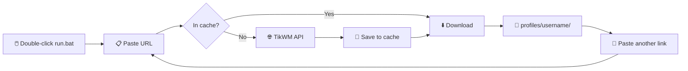

<div align="center">

# 🎬 Ez-TikTok-Downloader

### *Download TikTok videos without watermark — elegant, cached, and folder-per-creator.*

[](https://www.python.org/)
[](./LICENSE)
[](https://github.com/AlexRabbit)

**🚫 No watermark · 📺 Original quality · 💾 Smart link cache · 📁 Archivist-friendly filenames · 🔁 Continuous downloads**

If this helped you, consider starring the repo ⭐

[📥 Download ZIP](https://github.com/AlexRabbit/Ez-TikTok-Downloader/archive/refs/heads/main.zip) · [🌐 Browser Userscript](https://github.com/AlexRabbit/Userscripts)

</div>

---

## 🚀 Start here — double-click `run.bat`

> **This is the main way to use Ez-TikTok-Downloader.** No terminal skills required.

| Step | What to do |
|:----:|------------|
| **1️⃣** | Extract the project folder anywhere on your PC |
| **2️⃣** *(first time only)* | Double-click **`dependencies.bat`** → wait for **Setup complete** → close the window |
| **3️⃣** | Double-click **`run.bat`** |
| **4️⃣** | Paste a TikTok URL and press **Enter** |
| **5️⃣** | Find your video in the **`profiles`** folder 🎉 |
| **6️⃣** | Paste another link — keep going! Type **`quit`** when you're done |

```
   📂 Ez-TikTok-Downloader
   ├── dependencies.bat   ← run ONCE (first time setup)
   ├── run.bat            ← double-click THIS every time ⭐
   ├── tt.py
   └── profiles/          ← your downloads appear here
```

> 💡 **First launch?** Run `dependencies.bat` once before `run.bat`. It installs Python (if needed) and the required packages. After that, you only need `run.bat`.

---

## 🎯 What is this?

**Ez-TikTok-Downloader** by [AlexRabbit](https://github.com/AlexRabbit) is a small, no-nonsense Windows-friendly tool that downloads TikTok content without the watermark overlay.

| Feature | Description |
|--------|-------------|
| 🌐 **Original quality** | Uses the TikWM API for direct, no-watermark video links |
| 🖼️ **Photo/slideshow fallback** | If TikWM fails on a photo post, falls back to `gallery-dl` |
| 🔐 **Private videos** | Add your TikTok session ID to download friends-only content |
| 🚫 **No watermark** | Saves clean video files — no TikTok logo overlay |
| 📁 **Organized by creator** | One folder per username (+ `story` / `highlight` subfolders) |
| 📅 **Smart filenames** | `YY-mm-dd - ProfileUniqueID - Username - VideoID` — sortable & archivist-friendly |
| 💾 **Link cache** | Download links are saved locally — crashes won't force re-extraction |
| 📄 **Batch from .txt** | Drop many URLs in a text file and point the tool at it |
| 🔁 **Continuous mode** | Download one video after another without restarting — no "Press any key" |

You run it, paste a link, and it downloads. Paste another. Repeat. Type `quit` to close.

---

## 🔄 How it works



---

## 📥 Full installation guide

### Prerequisites

- **Windows 10/11** (recommended — `.bat` launchers included)
- Internet connection
- *(Optional)* TikTok account — only needed for private/friends-only videos

### Step 1 — Get the project 📦

**Option A — Download ZIP (easiest):**

1. Go to [github.com/AlexRabbit/Ez-TikTok-Downloader](https://github.com/AlexRabbit/Ez-TikTok-Downloader)
2. Click **Code → Download ZIP**
3. Extract to a folder, e.g. `C:\Tools\Ez-TikTok-Downloader`

**Option B — Git clone:**

```batch
git clone https://github.com/AlexRabbit/Ez-TikTok-Downloader.git
cd Ez-TikTok-Downloader
```

### Step 2 — One-time setup 🔧

1. Open the project folder in **File Explorer**
2. **Double-click `dependencies.bat`**
3. A Command Prompt window opens and:
   - ✅ Finds Python — or installs it via **winget**
   - ✅ Upgrades **pip**
   - ✅ Installs packages from `requirements.txt` (`requests`, `gallery-dl`)
4. When you see **"Setup complete"**, close the window

> ⚠️ **If Python was just installed:** close the window, open a **new** Command Prompt, go back to the project folder, and run **`dependencies.bat`** again.

> 💡 **No winget?** Install Python manually from [python.org](https://www.python.org/downloads/) — check **"Add Python to PATH"** during setup — then run `dependencies.bat` again.

### Step 3 — You're ready ✅

**Double-click `run.bat`** and paste your first TikTok URL!

---

## 🎮 How to use

### 🔁 Download one video after another (default)

1. **Double-click `run.bat`**
2. Paste a TikTok URL when prompted:
   ```
   https://www.tiktok.com/@creator/video/7123456789012345678
   ```
3. Press **Enter** — wait for `Downloaded: ...`
4. You'll see:
   ```
   Download completed! Paste another link, or type quit to exit.
   ```
5. Paste the next URL — repeat as many times as you want
6. Type **`quit`**, **`exit`**, or **`q`** when you're done

No window closing. No "Press any key to continue". Just keep pasting links.

### 📄 Batch download from a `.txt` file

1. Create a text file (e.g. `my_links.txt`)
2. Put **one TikTok URL per line**
3. Run **`run.bat`**
4. When prompted, enter the full path:
   ```
   C:\Users\You\Desktop\my_links.txt
   ```
5. All links are processed (with a short delay between each)
6. After the batch finishes, paste another link or type `quit`

### ⌨️ Command line (optional)

Pass a URL directly — after it downloads, the continuous loop still runs:

```batch
python tt.py "https://www.tiktok.com/@creator/video/7123456789012345678"
```

```batch
python tt.py "C:\path\to\urls.txt"
```

---

## 📂 Where do my files go?

Everything saves to a **`profiles`** folder inside the project directory:

```
profiles/
└── creator_username/
    ├── 25-06-15 - 6789012345678901234 - creator_username - 7123456789012345678.mp4
    ├── story/
    │   └── ...
    └── highlight/
        └── ...
```

### 📅 Filename format

Every file follows this pattern:

```text
YY-mm-dd - ProfileUniqueID - Username - VideoID.ext
```

| Part | Meaning | Example |
|------|---------|---------|
| **YY-mm-dd** | Post date (UTC) | `25-06-15` |
| **ProfileUniqueID** | TikTok's numeric user ID | `6789012345678901234` |
| **Username** | @handle | `creator_username` |
| **VideoID** | Post / video ID | `7123456789012345678` |

**Full example:**

```text
25-06-15 - 6789012345678901234 - creator_username - 7123456789012345678.mp4
```

Slideshows use the same base name plus `_img_1`, `_img_2`, etc. (`.jpg`, `.png`, …).

> 📌 **Upgrading from an older version?** Previously downloaded files keep their old names. New downloads use the updated format above.

---

## 🔐 Private videos (session ID)

To download **private** or **friends-only** videos, provide your TikTok **session ID** cookie.

### Setup

1. Copy **`sessionid.txt.example`** → **`sessionid.txt`**
2. Log in to [tiktok.com](https://www.tiktok.com) in your browser
3. Open **Developer Tools** (F12) → **Application** → **Cookies** → `https://www.tiktok.com`
4. Find the **`sessionid`** cookie and copy its **Value**
5. Open `sessionid.txt` and paste the value on one line (no quotes):

   ```text
   5b1e4c753e7f00fc5400d85856eb0d67
   ```

   You can also use: `sessionid=5b1e4c753e7f00fc5400d85856eb0d67`

6. Save and run **`run.bat`** as usual

When detected, you'll see:

```text
Using session ID from sessionid.txt (private videos supported).
```

To stop using your session: delete `sessionid.txt` or clear its contents.

> ⚠️ **Keep `sessionid.txt` secret.** Never share it or upload it to GitHub. Anyone with it can act as your logged-in account.

---

## 🖼️ Photo / slideshow fallback (`cookies.txt`)

For **photo/slideshow** posts the flow is:

**TikWM (with `sessionid.txt`) → if that fails → gallery-dl with `cookies.txt`**

### Setup

1. Copy **`cookies.txt.example`** → **`cookies.txt`**
2. Install a cookie export extension (e.g. **Get cookies.txt LOCALLY** or [Cookie-Editor](https://cookie-editor.com))
3. Log in to TikTok, export cookies for `tiktok.com` in **Netscape format**
4. Paste the exported content into `cookies.txt`
5. Save and run as usual

> ⚠️ **Keep `cookies.txt` secret** — do not commit or share it.

---

## 💾 The link cache

Fetching a download link from TikWM takes a few seconds. If you're downloading 50 videos and the app crashes at #30, you don't want to start over.

| Step | What happens |
|------|-------------|
| 1️⃣ First time | TikWM API is called → link saved to **`link_cache.json`** → file downloaded |
| 2️⃣ Next time | Cache is checked first → **`[Cache] Using cached link for …`** → instant download |
| 3️⃣ After crash | Re-run `run.bat` → cached links reused → only missing videos call the API |

```
   🔄 Crash at video 30?  →  Run again  →  1–30 from cache ⚡  →  Only 31–50 hit the API
```

Delete `link_cache.json` anytime to start with a fresh cache.

---

## 📁 Project files

| File | Purpose |
|------|---------|
| **`run.bat`** | ⭐ **Main launcher** — double-click this |
| **`dependencies.bat`** | One-time setup (Python + packages) |
| **`tt.py`** | Core downloader script |
| **`requirements.txt`** | Python dependencies |
| **`sessionid.txt.example`** | Template for private video access |
| **`cookies.txt.example`** | Template for photo/slideshow fallback |
| **`LICENSE`** | Unlicense (public domain) |

**Generated locally (not in repo):**

| File / folder | Purpose |
|---------------|---------|
| `profiles/` | Your downloaded videos & images |
| `link_cache.json` | Cached download links |
| `sessionid.txt` | Your TikTok session (you create this) |
| `cookies.txt` | Your TikTok cookies (you create this) |

---

## 🔧 Troubleshooting

| Problem | What to try |
|--------|-------------|
| **"Python not found"** | Run **`dependencies.bat`**. If Python was just installed, close the window, open a new one, run **`dependencies.bat`** again. |
| **"No module named 'requests'"** | Open Command Prompt in the project folder: `pip install -r requirements.txt` |
| **"Extraction failed"** | Link may be invalid, private, or TikWM is busy. For `/photo/` links, add `cookies.txt`. For private videos, add `sessionid.txt`. |
| **"File not found" (.txt batch)** | Use the **full path** to your file, e.g. `C:\Users\You\Desktop\urls.txt` |
| **Video won't play** | Wait until `Downloaded: …` appears — the file may still be writing |
| **Window closes immediately** | Run `dependencies.bat` first. If Python is missing, the window may flash and close. |
| **Old filename format** | Only new downloads use the updated naming. Delete old files to re-download with new names. |

---

## ❓ FAQ

**Q: Do I need a TikTok account?**  
A: No — public links work out of the box.

**Q: Can I download private videos?**  
A: Yes — create `sessionid.txt` from the example template. For private photo posts, also add `cookies.txt`.

**Q: Where is the cache?**  
A: `link_cache.json` in the project folder. Safe to delete.

**Q: Can I change the download folder?**  
A: Run the script from whichever folder you want `profiles/` to appear in: `cd C:\Videos` then `python C:\path\to\tt.py`.

**Q: Does it work on Mac / Linux?**  
A: The `.bat` files are Windows-only, but `python tt.py` works anywhere Python 3.8+ is installed.

**Q: Is this against TikTok's terms?**  
A: Use it only for content you're allowed to download (your own, or with permission). You are responsible for how you use this tool.

**Q: Prefer downloading from the browser?**  
A: Check out my [TikTok download Userscript](https://github.com/AlexRabbit/Userscripts) — works directly in your browser.

---

## 🙏 Acknowledgements

- **[TikWM](https://www.tikwm.com)** — API for no-watermark download links
- **[gallery-dl](https://github.com/mikf/gallery-dl)** — photo/slideshow fallback
- **[AlexRabbit](https://github.com/AlexRabbit)** — creator & maintainer

---

<div align="center">

**Made with ❤️ by [AlexRabbit](https://github.com/AlexRabbit)**

*If you found it useful, a ⭐ on GitHub is always appreciated.*

<br>

<sub>🎬 Ez-TikTok-Downloader · No watermark · Cache · Session ID · Continuous downloads · Profiles folder</sub>

</div>
